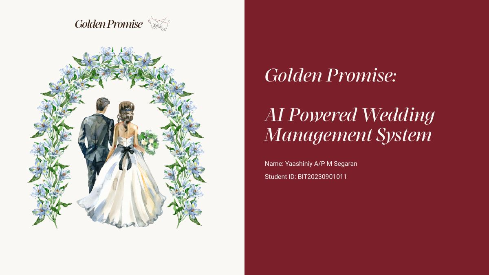
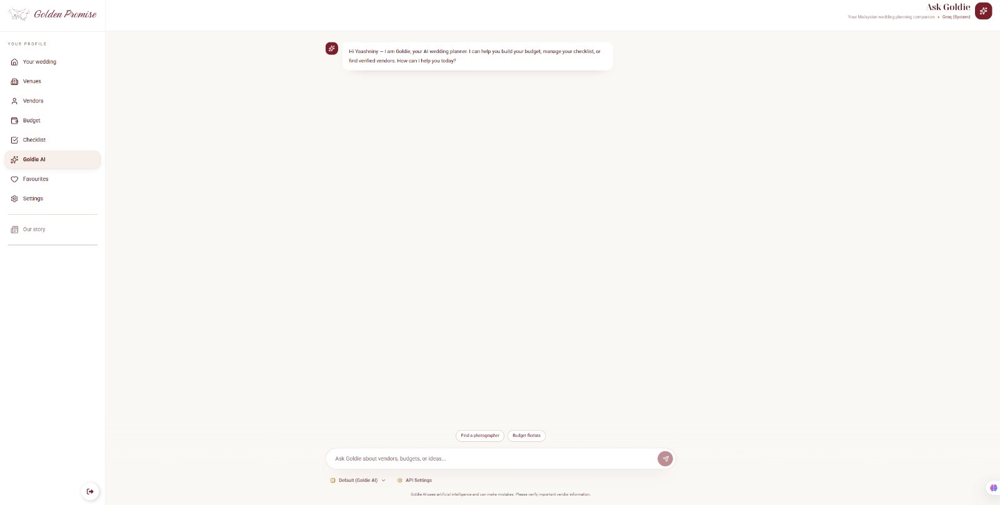
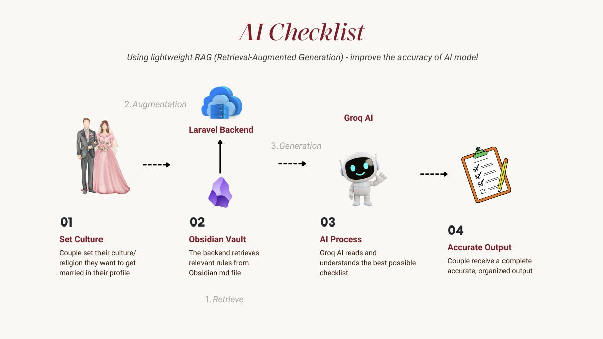
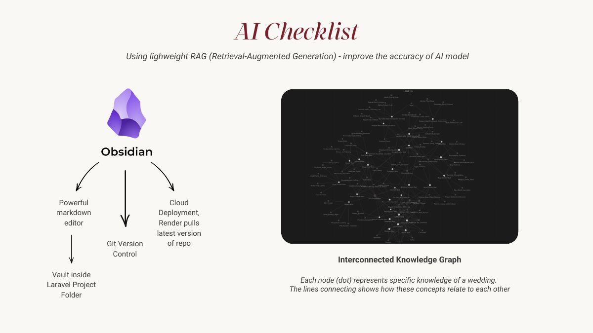

# Golden Promise 💍

**An AI-powered wedding planning platform for Malaysian couples.**
It lists verified vendors and has an AI planner that understands Malaysia's many wedding traditions.

> Final Year Project · Bachelor of Information Technology (Hons) · Asia Metropolitan University
> Built by **[Yaashiniy Segaran](https://yaashiniy-portfolio.vercel.app)**



---

## The problem

Malaysian weddings typically cost **RM30,000 to RM120,000**. Couples often find vendors through social media and pay large deposits to "phantom" vendors who then disappear. Planning is also spread across many apps, and generic tools ignore the cultural requirements of Malay, Chinese, Indian, Sikh, Kadazan and mixed weddings.

## The solution

| Feature | What it does |
|---|---|
| ✅ **Verified directory** | Vendors upload legal documents, and an admin checks them before the vendor gets a "Verified" badge |
| ✨ **Goldie AI planner** | Uses RAG over a knowledge vault of Malaysian wedding traditions to give advice that fits each culture |
| 💰 **Budget planner** | Splits the couple's budget by category automatically, based on their city and tradition |
| 📋 **Smart checklist** | Generates tasks with deadlines for each tradition |
| 🔑 **Bring Your Own Key** | Users can plug in their own AI API key, stored with AES-256 encryption |
| 💬 **Direct contact** | WhatsApp deep links, so vendors keep 100% of their business |



## How the AI works

Goldie uses **lightweight Retrieval-Augmented Generation (RAG)**:

1. The couple sets their culture or tradition in their profile
2. The Laravel backend retrieves the matching rules from a Markdown knowledge vault (written in Obsidian)
3. The rules are added to the prompt and sent to **Groq (Llama 3.3 70B)**
4. **Function calling** lets Goldie search the real vendor database and update the couple's dashboard

| RAG flow | Knowledge graph |
|---|---|
|  |  |

## Tech stack

| Layer | Technology |
|---|---|
| Frontend | React 19, Vite, Tailwind CSS, Framer Motion, GSAP, Leaflet, TanStack Query |
| Backend | Laravel 12, Sanctum (SPA cookie auth) |
| Database | PostgreSQL (Aiven) |
| AI | Groq API (Llama 3.3 70B), RAG over an Obsidian Markdown vault |
| Hosting | Vercel (frontend), Render (backend) |
| Development | Agentic engineering with AI coding agents, VS Code, Git |

## Built with agentic engineering

I built the full system in **about 3 months** by working with AI coding agents. They wrote most of the code, and I focused on the system architecture, database design, security and business logic. [`AGENTS.md`](AGENTS.md) is the context file I wrote to guide the agents.

## Project structure

```
frontend/         Couple-facing React app
admin-frontend/   Admin & vendor portal
backend/          Laravel 12 API (controllers, models, migrations, RAG knowledge vault)
docs/             Flowcharts, Gantt chart, screenshots
```

## Running locally

**Backend**
```bash
cd backend
composer install
cp .env.example .env        # then add your DB settings and GROQ_API_KEY
php artisan key:generate
php artisan migrate --seed
php artisan serve
```

**Frontend**
```bash
cd frontend
npm install
npm run dev
```

> The seeders create demo accounts with simple passwords for local testing only. Change them before deploying anywhere public.

---

**Author:** Yaashiniy Segaran · [Portfolio](https://yaashiniy-portfolio.vercel.app) · [LinkedIn](https://www.linkedin.com/in/yaashiniy)
